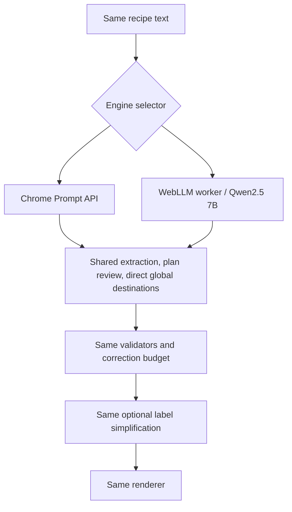

# Comparing browser-local engines

This is an experiment, not a claim that either engine reliably understands recipes. Choose **Chrome built-in AI** or **WebLLM · Qwen2.5 7B** above the editor and run the same unchanged source twice. Copy each diagnostic report and output snapshot before starting the next run; the dialog shows only the current run. Both paths use the single `convertRecipe` implementation. There is no automatic fallback between engines.

## What stays fixed

Source, system prompts, stage ordering, JSON schemas, validators, one extraction/plan correction plus one separate graph correction, streaming guards and renderer are shared. Each stage starts without prior chat history. WebLLM keeps weights loaded between stages but resets its chat. Cancellation terminates the worker; a later conversion can reuse cached downloads. No English cooking rules are introduced.

## What differs

| Setting | Chrome | WebLLM |
| --- | --- | --- |
| Model | Browser-managed; exact build unknown to the app | `Qwen2.5-7B-Instruct-q4f16_1-MLC` |
| Runtime | Installed browser | Pinned `@mlc-ai/web-llm@0.2.86` |
| Sampling | `most-predictable` | Temperature 0 |
| Structured output | `responseConstraint` | `response_format` JSON schema |
| Context | Browser-managed | 16,384 tokens |
| Inference deadline | 10 minutes | 30 minutes |
| Response limit | Browser-managed plus shared application guards | 4,096 tokens plus shared application guards |

Chrome may inject schema guidance internally; WebLLM compiles its schema constraints differently. Tokenizers, quantization, model templates and hardware execution also differ. These are not equivalent sampling or resource settings. This compares **two complete local engines using our pipeline**, not model intelligence in isolation. The pipeline was developed against Chrome and may favor it. A separate future experiment could optimize pipelines per engine, but should not mix those results with this controlled comparison.

WebLLM requires WebGPU and substantial GPU memory. This 7B model downloads several GB; a 16K context needs additional memory. A successful capability check does not establish enough memory. No smaller model is silently substituted. The first conversion downloads runtime/model files from a CDN and model hosts; recipe text stays in local inference. Network access is needed for uncached assets. The static site still works on GitHub Pages without a build step.

## Evaluate outcomes, not just green checks

Use the same recipe text, browser/device and pipeline revision. Keep the tab visible. Record model/settings from each report, first-load versus cached startup, conversion time and corrections. Inspect ingredient completeness, amounts, qualifiers, operations, branches and joins, and numeric accuracy of shortened labels. Repeat runs and record failures as well as successes. A structurally valid graph can still be a wrong recipe. The first user-reported WebLLM/Qwen2.5 7B run failed semantic extraction: it dropped quantities and returned a one-action plan. See the [lessons](lessons-learned.md#first-reported-webllm-run-larger-model-did-not-resolve-extraction) and archived trace. This is not a paired benchmark; automated tests still verify adapter behavior only.

References: [WebLLM](https://github.com/mlc-ai/web-llm), [Chrome Prompt API](https://developer.chrome.com/docs/ai/prompt-api).

## Initial paired observations

The user-reported Halloween Muffins runs failed with both engines. Chrome split names from quantities and copied action-prompt placeholders; WebLLM dropped quantities and collapsed the method. Both failed action-source validation. Neither is a winner. These snapshots lack complete run metadata and a separately captured original input, so they are exploratory evidence, not a controlled benchmark. See [the comparison lessons](lessons-learned.md#chrome-comparison-shared-task-failure-different-symptoms).

## What we learned

1. **A larger model is not a demonstrated fix.** Qwen2.5 7B failed this extraction task, as did Chrome. Two failed runs do not establish which engine is generally more capable.
2. **Valid fragments are not complete ingredients.** Names without quantities and quantities without names can each match the source exactly. Our quotation check establishes provenance, not correct grouping or coverage.
3. **Prompt examples can leak into answers.** Chrome copied the illustrative `complete instruction` value. Example wording is part of the experiment and must be inspected alongside model output.
4. **The reported validation error is not the full diagnosis.** Both action plans contained semantic defects before the final citation mismatch. Fixing only that mismatch would still leave unusable recipes.
5. **Corrections can make output worse.** The observed correction attempts introduced new omissions, duplications and altered text. A retry is not evidence of progress.
6. **Downstream graph work cannot rescue missing recipe information.** Ingredient and action extraction must be evaluated independently before judging the association stages.
7. **Tests and browser observations answer different questions.** Mocked tests establish orchestration and validation behavior. Only real outputs reviewed against the actual source establish recipe accuracy.

## Next experiment: isolate extraction

This is a proposed experiment, not an implemented pipeline change.

Capture the exact submitted text, pipeline revision, browser, backend/model settings and raw outputs. Use the same source for both engines, with fresh sessions and unchanged budgets. Evaluate ingredients and actions separately, without graph generation.

First establish a baseline with the current prompts and JSON constraints. Then remove illustrative placeholder values while retaining the same JSON contract; this isolates the prompt-format change. Finally compare that revised prompt with a matched ordinary-text version without schema constraints. The last comparison necessarily changes output-format instructions as well as decoding constraints, so it cannot isolate the grammar implementation alone.

Repeat each condition and retain all failures. Score name/quantity grouping, ingredient coverage, qualifiers, action coverage, setup classification, and unchanged numbers against the original source. Record formatting failures separately from semantic failures. Do not automatically merge detached quantities, infer missing ingredients, or relax production validation to make a run pass.

## WebLLM time budget

Following further reported WebLLM timeouts, the page now allows 30 minutes of inference for WebLLM, while Chrome retains 10 minutes. The dialog and copied report show the selected limit. This is one shared budget for all conversion stages and correction, not 30 minutes per request. Cancel and output/repetition guards remain active.

Initial model loading has a separate two-minute inactivity timer, refreshed by download progress. It is not part of the inference budget, which starts when the first session is ready. A loading timeout therefore needs separate investigation. More inference time may allow a slow run to finish; it does not improve semantic correctness or remove context/output limits. These unequal time budgets must be disclosed when comparing completion rates and latency.

V13 changes both engines together: no provisional linking requests, revised setup/action instructions without illustrative placeholder values, and one reserved graph correction. This is a combined pipeline revision, not a single-factor experiment. Compare it with v12 as a whole; do not attribute any accuracy change to one component without further testing.

## V14: extraction constraints experiment

Expand **Extraction experiment** below the engine selector. **Enforce JSON format during extraction** is checked by default (baseline). Uncheck it for ordinary generation during ingredients, cooking actions and plan review, including their correction. Run the same unchanged source twice with the same engine; then repeat with the other engine. Record failures as well as successes.

Both conditions receive identical application prompts and an explicit `output_schema` in the request. The unchecked condition omits Chrome's `responseConstraint`/`omitResponseConstraintInput` options and WebLLM's `response_format`. It still asks for JSON; this tests native JSON enforcement, not a free-form prose extraction task. Chrome may internally add schema guidance when enforcement is enabled, so internal model inputs are not guaranteed identical.

JSON parsing, source/numeric validation, correction budgets, time limits and whitespace guards remain unchanged. There is no Markdown stripping or salvage of malformed output. Graph generation and optional labels stay constrained in both conditions. Reports and snapshots include the extraction mode and per-request constraint setting.

The pipeline identifier is `model-led-v14-extraction-comparison`. Adding explicit schema text changes the baseline relative to v13: compare the two v14 conditions to isolate enforcement, rather than attributing every v13/v14 difference to constraints. No real-browser accuracy improvement has been established.
