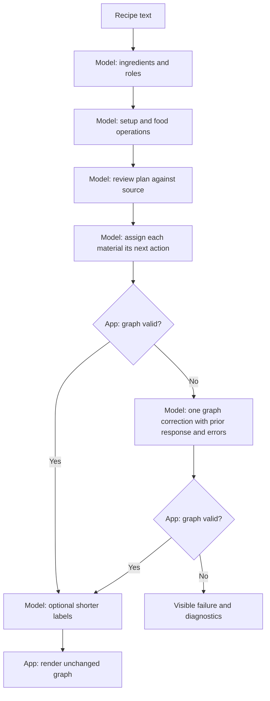

# Browser-local AI pipeline

[README](../README.md) · [Architecture](architecture.md) · [Lessons learned](lessons-learned.md) · [Engine comparison](backend-comparison.md)

Current version: **model-led-v14-extraction-comparison**. Both engines use this single pipeline. No provisional linking calls are made.

Extraction and plan review share one correction. Graph interpretation has its own single correction, even if extraction used its allowance. Malformed or invalid graph output can use this correction; transport failure, cancellation and deadlines cannot. A completed invalid response is included with feedback; a streaming guard failure supplies feedback without salvaging partial JSON. Every retry receives the original source and fixed data. All stages share the selected engine's deadline.

Ingredients are model-selected verbatim excerpts with inferred roles. The model classifies setup versus food operations and reviews the full plan. Prompts no longer supply `complete instruction` as an example value. Equipment-only operations belong in setup; setup must not contain the recipe or ingredient inventory. These are model instructions, not English matching rules in code. Semantic completeness still requires inspection.

The graph request contains the full source, ingredient roles and fixed actions/excerpts. Its output maps each ingredient and nonfinal result to its next consuming action. Code regroups those destinations and validates all references, nonempty actions and connectivity. Feedback lists all empty actions; code never chooses replacement edges. Graph correction cannot repair a missing or misclassified operation in the fixed plan.

Labels may change wording only; they cannot change graph structure. Failed optional shortening retains full wording. Reports preserve model outputs, correction category and timing. The historical [draft-and-review pipeline](global-graph-review.md) explains earlier experiments, not the current runtime.

## Extraction constraint comparison

V14 adds a checked-by-default **Enforce JSON format during extraction** switch under **Extraction experiment**. Turning it off removes engine-enforced JSON constraints only for ingredients, operations and plan review. Explicit schema instructions and validators remain the same in both modes. Graph and label constraints remain enabled. See [comparison protocol](backend-comparison.md#v14-extraction-constraints-experiment).
