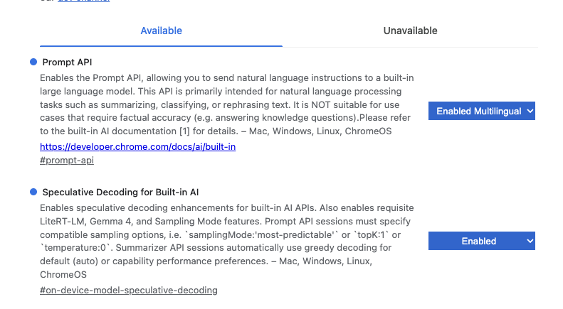

# Setup and troubleshooting

[Back to README](../README.md) · [Architecture](architecture.md) · [Failure history and lessons](lessons-learned.md)

## Chrome development settings

The screenshot supplied during development shows this configuration in `chrome://flags`:

| Setting | Selected value | Direct flag address |
| --- | --- | --- |
| Prompt API | Enabled Multilingual | `chrome://flags/#prompt-api-for-gemini-nano` |
| Speculative Decoding for Built-in AI | Enabled | `chrome://flags/#on-device-model-speculative-decoding` |

Relaunch Chrome after changing flags, then reload the app. These are the settings shown in the supplied development environment, not a guarantee that all Chrome versions expose the same menu or that flags override hardware eligibility.

The app requests `samplingMode: 'most-predictable'` for both availability and session creation to support the shown speculative-decoding configuration. Chrome's current web documentation describes sampling-mode access through an origin trial; a development flag setup is not evidence that the same feature is enabled for visitors to a hosted page. See the [official Prompt API documentation](https://developer.chrome.com/docs/ai/prompt-api) for current availability and enrollment details (checked 2026-10-20).

## The AI API or model is unavailable

1. Use localhost or HTTPS, rather than opening `index.html` as a file.
2. Check the app's capability message and Chrome's supported device requirements linked from the README.
3. Check the development settings above and relaunch if changed.
4. Open `chrome://on-device-internals` to inspect model readiness. The first conversion can require a model download; keep the page visible during initialization.
5. Use **Try demo** or Manual JSON while investigating. Neither needs local AI.

The app never silently substitutes demo output when inference fails.

## Conversion stalls or fails

Model initialization has a separate two-minute inactivity timeout, refreshed by download progress. Once the first session is ready, extraction, plan review, direct global graph interpretation and labels share 10 minutes for Chrome or 30 minutes for WebLLM. Extraction/plan review has one correction; graph interpretation has one separate correction. There are no provisional linking calls in v13. Cancellation remains available. The progress modal stays open on failure and closes after a valid grid renders.

Copy the diagnostic report and, when useful, inspect or print the current output snapshot. Include the pipeline version, failed stage/action, generated interpretation and offered input choices. Source text appears in opt-in snapshots, so review it before sharing. A failed final action can be the consequence of an earlier missed input; increasing the timeout or adding leftovers at the last step does not repair that mistake.

Character counts measure JavaScript string length (UTF-16 code units). Chunks are pieces delivered by the streaming API, not tokens, and can vary in size. Neither count is a token count. A browser output-length error or a repetitive whitespace stream is different from an elapsed-time timeout.

See the [historical investigations](lessons-learned.md) for the observed MTP errors, repetition, schema rejection, duplicate inputs and missing ingredient cases.

## The grid looks incomplete or a label stays long

Compare with the source and the original steps in the text view. Source-excerpt checks and graph validation do not prove that extraction included every ingredient or that all connections reflect the intended cooking process. The table requires a single-consumer dependency tree; shared subrecipes need explicit portions or manual editing.

Procedure shortening changes only display labels. Full model-generated wording remains in the text view, JSON and hover text; the original recipe remains in the source editor. A cell stays long when the model returns the full instruction, a longer/empty label is rejected, or the optional label request fails. The model writes labels freely; code does not verify that the shorter wording preserves every semantic detail. Manual JSON edits return to original labels. The known omissions and representation limits are recorded in the lessons file.

## Hosting on GitHub Pages

The project is static and uses relative asset paths; no build command or server-side AI service is needed. GitHub Pages supplies HTTPS, but hosting does not enable Chrome AI capabilities on a visitor's device. Test Demo, Manual JSON and automatic conversion separately on the deployed origin. The sampling-mode setup may differ from localhost development.

See [GitHub's publishing-source guide](https://docs.github.com/en/pages/getting-started-with-github-pages/configuring-a-publishing-source-for-your-github-pages-site) for deployment settings. This documentation does not imply that Pages has been enabled for the repository.

## WebLLM loading or inference errors

WebLLM needs WebGPU, enough GPU memory, and network access for uncached runtime/model assets. Chrome Prompt API flags do not enable WebLLM. Copy the latest output snapshot: it includes backend settings and timing history, refreshes when copied, and refreshes an open snapshot on failure. A shared deadline failure does not mean the final stage ran for the entire budget. See [engine comparison](backend-comparison.md).
